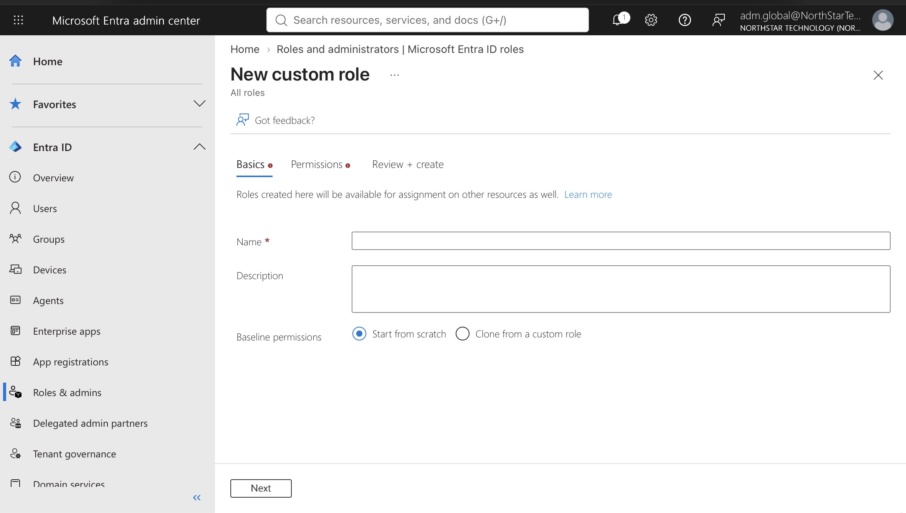
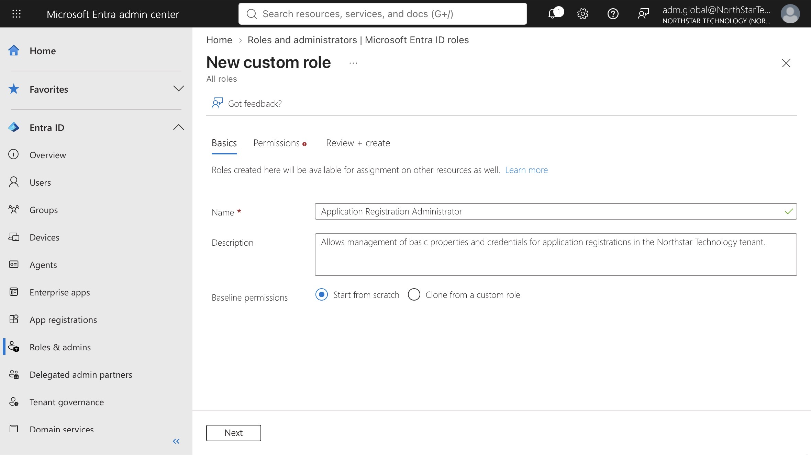
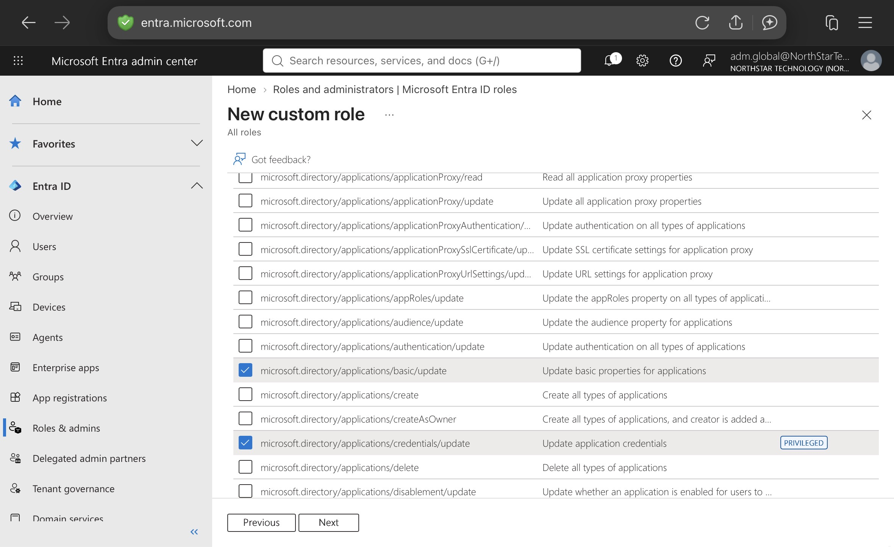
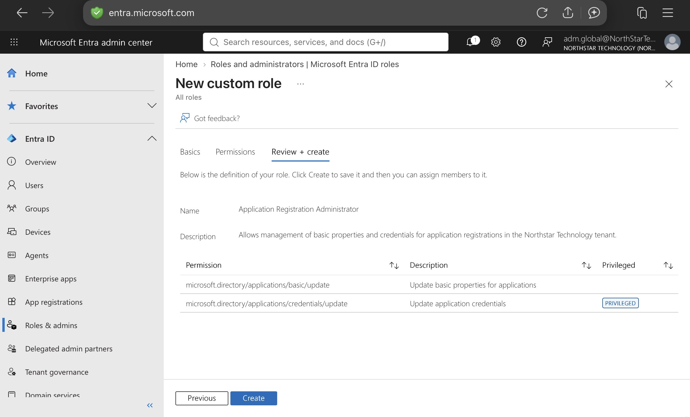
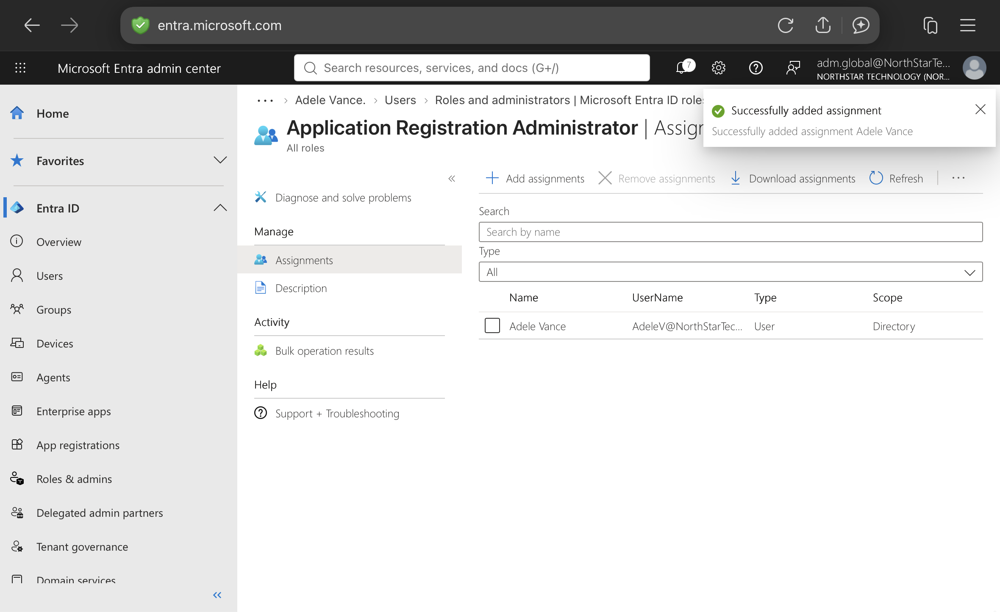
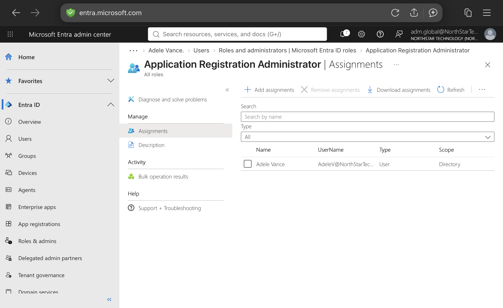
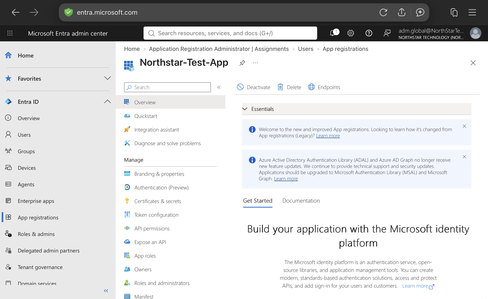
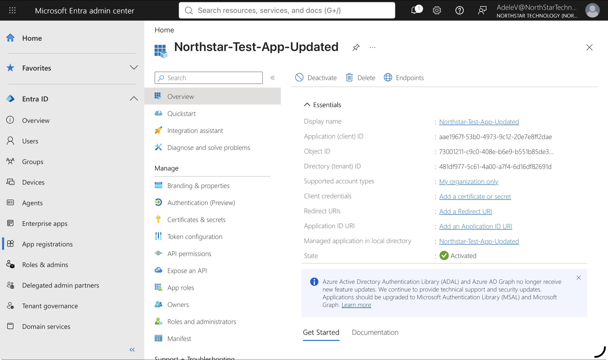
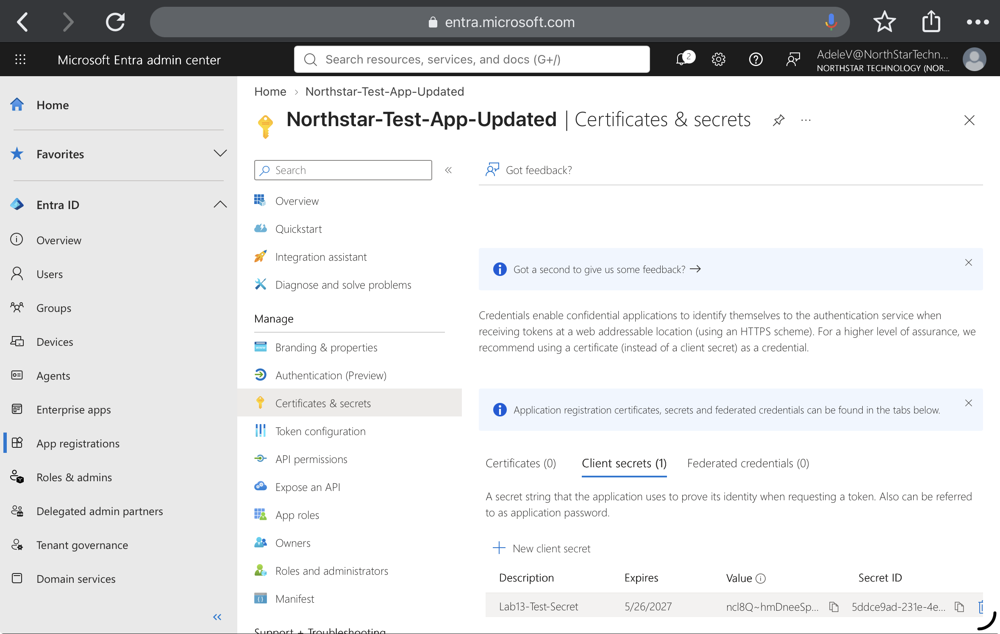

# Lab 13: Configure and Manage Microsoft Entra Roles

## Objective

Create a custom Microsoft Entra role, assign it to a test user, and verify that the assigned permissions allow application property and credential management.

## 1. Create a Custom Role

Navigate to Microsoft Entra ID → Roles and administrators → New custom role.

Configure the following:

- Role Name: Application Registration Administrator
- Description: Allows management of basic properties and credentials for application registrations in the Northstar Technology tenant.
- Baseline Permissions: Start from scratch

Add the following permissions:

| Permission | Description |
|---|---|
| `microsoft.directory/applications/basic/update` | Update basic application properties. |
| `microsoft.directory/applications/credentials/update` | Manage application credentials. |

Review the selected permissions before creating the custom role.

## 2. Assign the Custom Role

Open the newly created role and select Add assignments.

Assign the Application Registration Administrator role to a dedicated test user. Verify that the account appears in the assignment list.

## 3. Create a Test Application

Using the Global Administrator account, navigate to:

Microsoft Entra ID → Applications → App registrations → New registration

Register an application with these settings:

- Name: Northstar-Test-App
- Supported Account Types: Accounts in this organizational directory only
- Redirect URI: Leave blank

Select Register to create the application.

## 4. Verify Basic Application Property Permissions

Sign in to the Microsoft Entra admin center using the dedicated test user account.

Open App registrations → Northstar-Test-App → Manage → Properties.

Verify that the Display name field is editable. Temporarily change the display name and select Save.

The update completed successfully, confirming that the assigned custom role permits changes to basic application properties.

## 5. Verify Application Credential Permissions

While signed in as the test user, navigate to:

Northstar-Test-App → Manage → Certificates & secrets → Client secrets

Select New client secret and create a temporary secret with the description Lab13-Test-Secret.

The portal successfully created the client secret, confirming that the assigned custom role permits application credential management.

The secret value was not included in the documentation or screenshots.

## 6. Cleanup

After completing the permission tests:

- Deleted the temporary client secret.
- Restored the application's original display name, Northstar-Test-App.
- Confirmed that the temporary credential was no longer needed.

## Key Takeaways

- Custom Microsoft Entra roles provide granular control over administrative permissions.
- Specific permissions can be assigned without granting broader administrative privileges.
- Testing with a separate account helps verify that role assignments work as intended.
- Application property and credential management permissions can be tested independently.
- Temporary credentials should be removed after testing and must never be exposed in public repositories.
